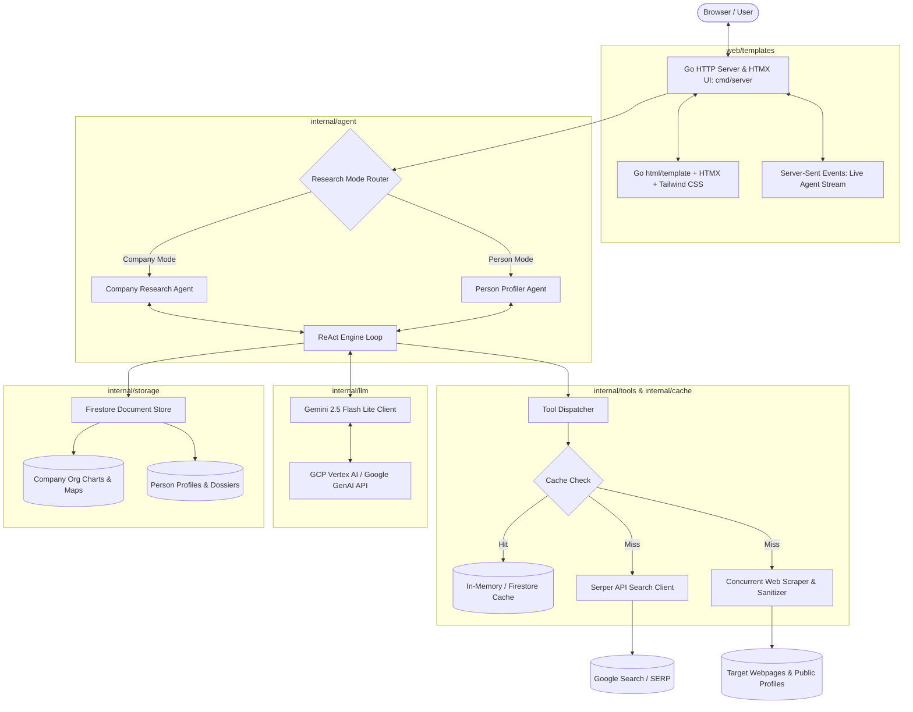
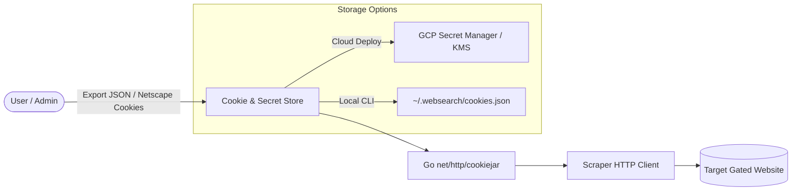

# High-Level Design (HLD) & System Architecture: WebSearch_GO

## 1. Overview & System Design

`WebSearch_GO` is an Agentic AI system written in idiomatic Go and hosted natively on Google Cloud Platform (GCP). It performs autonomous web-based research along two specialized tracks:
1. **Company Research**: Gathers corporate footprint, extracts executive structure, builds hierarchical org charts, and enables functional/regional drill-downs.
2. **Person Research**: Conducts disambiguation, aggregates multi-source career footprints, and synthesizes structured candidate/professional dossiers.

---

### System Architecture Diagram

---

## 2. Frontend, Storage & Caching Architecture

### A. Go-Native Frontend (HTML5 + HTMX + Tailwind CSS)
* **Architecture**: Server-Side Rendered (SSR) using Go's standard `html/template` combined with **HTMX** for dynamic, SPA-like interactions without Node.js or JavaScript build toolchains.
* **Real-time Updates**: Server-Sent Events (SSE) streaming live agent thought chains, search queries, and scraping status directly into the browser.
* **Interactive Drill-Down**: Tree-view org charts and departmental/regional filtering powered by HTMX partial component swaps.

### B. Data Storage & Persistence (GCP Firestore)
* **Google Cloud Firestore (Native Mode)**:
  * Serverless NoSQL document store with automatic scaling and zero idle cost.
  * Collections:
    * `companies`: Stores company metadata, executive hierarchy, departments, and snapshot timestamp.
    * `persons`: Stores disambiguation history, career timeline, education, skills, and summary dossiers.
    * `research_sessions`: Stores execution logs, raw search queries, and agent reasoning traces.

### C. Caching Behavior & Cost Optimization
* **Multi-Tier Caching**:
  1. **Search Cache (TTL: 48h)**: Hashes query strings (`SHA256(query)`) and stores Serper API JSON responses in memory/Firestore to prevent duplicate paid API calls.
  2. **Scraper Cache (TTL: 7d)**: Caches extracted, sanitized webpage text by normalized URL to reduce repeated outbound HTTP traffic and improve latency.
  3. **LLM Output Cache**: Reuses synthesis for identical entities within active research sessions.

---

## 3. Tech Stack Evaluation & Justification

| Component | Technology | Rationale & Trade-offs | Verdict |
| :--- | :--- | :--- | :--- |
| **Language** | **Go (Golang)** | High performance, ultra-fast cold starts (<100ms on Cloud Run), minimal RAM (~20–40 MB), and first-class goroutine concurrency for parallel scraping/searching. Single deployable binary. | **Optimal** |
| **Frontend** | **Go Templates + HTMX** | Zero Node/npm build dependencies; clean separation of concerns; enables live SSE streaming and dynamic partial swaps with minimal frontend complexity. | **Lean & Productive** |
| **LLM** | **Gemini 2.5 Flash Lite** | Lowest cost per million tokens ($0.075/1M), ultra-low latency for multi-turn agent loops, and vast context window for ingesting long scraped text. | **Cost-Effective** |
| **Search Engine** | **Serper API** | Low latency, clean structured JSON for Google search queries, and avoids heavy headless browser overhead (Puppeteer/Playwright). | **Pragmatic** |
| **Storage** | **GCP Firestore** | Serverless document database, flexible JSON/schema-less storage, generous free tier, scales to zero. | **Cloud-Native** |
| **Compute** | **GCP Cloud Run** | Fully managed container runtime, automatic HTTPS, built-in IAM auth with Vertex AI and Firestore, scales to zero when idle. | **Standard GCP Choice** |

---

## 4. Code Functionality & Module Contributions

| Module / Package | Path | Functional Contribution |
| :--- | :--- | :--- |
| **HTTP Gateway & Server** | `cmd/server/main.go` | Entry point. Sets up HTTP routing, initializes Firestore/Gemini clients, loads embedded HTML templates, and manages SSE streaming connections. |
| **Web UI & Templates** | `web/templates/` & `web/static/` | Go HTML templates and static assets for search input, disambiguation modals, live execution consoles, org chart visualizers, and dossier views. |
| **ReAct Agent Engine** | `internal/agent/engine.go` | Implements the core Reasoning + Acting loop. Drives iterative LLM reasoning, dispatches tool calls, captures observation outputs, and publishes status events to the SSE channel. |
| **Company Agent** | `internal/agent/company.go` | Coordinates multi-phase company discovery (domain search, leadership page extraction, executive hierarchy building, and departmental/regional drill-down formatting). |
| **Person Agent** | `internal/agent/person.go` | Drives the interactive disambiguation flow (solicits location/company constraints), queries career footprints across public sources, and aggregates data into an end-to-end dossier. |
| **Tool Dispatcher** | `internal/tools/registry.go` | Exposes unified tool interfaces and schema definitions to Gemini function calling. |
| **Search Tool** | `internal/tools/serper.go` | Executes structured web queries via Serper API (regular, news, and site-restricted queries) and returns sanitized snippets and links. |
| **Scraper Tool** | `internal/tools/scraper.go` | Concurrently fetches target webpage bodies, strips HTML boilerplate (scripts, styles, ads), and extracts concise text for LLM ingestion. |
| **Cache Manager** | `internal/cache/cache.go` | Provides in-memory LRU and Firestore-backed caching for web searches and scraped pages with configurable TTLs. |
| **Storage Repository** | `internal/storage/firestore.go` | Handles persistence and retrieval of company org charts, person dossiers, and research session traces in Cloud Firestore. |
| **Gemini Client** | `internal/llm/gemini.go` | Wraps the Google GenAI SDK to interface with `gemini-2.5-flash-lite`, configuring system instructions, tool declarations, token budgets, and structured JSON decoding. |
| **Data Models** | `internal/models/` | Defines Go structs for `OrgChart`, `Department`, `Employee`, `PersonProfile`, `Experience`, `Education`, and agent tool payloads. |

---

## 5. Implementation Plan

### Phase 1: Workspace Initialization & Environment Scaffolding
- Initialize the Go module (`go.mod`) with dependencies (`google.golang.org/genai`, `cloud.google.com/go/firestore`, `github.com/go-chi/chi/v5` or standard `net/http`).
- Establish the folder structure (`cmd/`, `internal/`, `web/`).
- Set up configuration loading for GCP project credentials and `SERPER_API_KEY`.

### Phase 2: Tooling, Caching & Data Extraction
- Implement `internal/tools/serper.go` for web search execution.
- Implement `internal/tools/scraper.go` with HTTP timeouts and HTML text sanitization.
- Implement `internal/cache/cache.go` for search and scrape TTL caching.
- Implement `internal/storage/firestore.go` for document persistence.

### Phase 3: Gemini Integration & ReAct Engine
- Implement `internal/llm/gemini.go` with Gemini 2.5 Flash Lite connectivity, function calling declarations, and structured JSON decoding.
- Implement `internal/agent/engine.go` with event broadcasting for SSE streaming.

### Phase 4: Domain Agents Implementation
- Implement `internal/agent/company.go` for org chart discovery and drill-down navigation.
- Implement `internal/agent/person.go` for disambiguation and candidate dossier compilation.

### Phase 5: Go-Native Web UI & SSE Live Stream
- Build embedded Go templates (`web/templates/index.html`, `org_chart.html`, `dossier.html`, `stream.html`).
- Wire HTMX partial updates and Server-Sent Events (SSE) in `cmd/server/main.go`.

### Phase 6: Verification & Cloud Run Containerization
- Add unit/integration tests for parser, caching, and agent loops.
- Build a lightweight multi-stage `Dockerfile` (distroless/alpine base) and test local execution before GCP deployment.

---

## 6. Scraping Engine Architecture & Stack Comparison

### A. Go Scraper Engine Pattern
The Go scraping engine is built around three pillars:
1. **Goroutine Concurrency Pool**: Fetches multiple target URLs in parallel with bounded worker pools.
2. **Hardened HTTP Client**: Implements strict timeouts, redirect caps, desktop `User-Agent` rotation, and gzip decompression.
3. **DOM Sanitization**: Uses `goquery` and `go-readability` to strip `<script>`, `<style>`, `<nav>`, `<footer>`, `<header>`, and ads, returning clean, high-density text for Gemini.

### B. Go vs. Python Scraping Stack Comparison

| Feature / Metric | **Go (`net/http` + `goquery` / `go-readability`)** | **Python (`aiohttp` + `bs4` / `goose3`)** | **Browser Engines (`playwright` / `chromedp`)** |
| :--- | :--- | :--- | :--- |
| **Execution Model** | Native Goroutines (M:N Go scheduler) | Single-threaded `asyncio` event loop | Headless Chromium process per session |
| **RAM (20 concurrent pages)** | **~15–30 MB** | ~100–180 MB | **~800 MB – 2 GB** |
| **Cold Start (Cloud Run)** | **< 80 ms** | 1.5 – 3.0 s | 5.0 – 10.0 s (heavy browser runtime) |
| **HTML Parsing Speed** | **Fastest** (Compiled native speed) | Slower (even with C-extensions) | Slowest (full DOM rendering) |
| **JS-Heavy SPAs** | Raw HTML only | Raw HTML only | **Full JavaScript execution** |
| **Deployment Artifact** | **Single static binary (~15MB)** | Virtualenv + large wheel dependencies | Requires OS-level browser binaries |

---

## 7. Handling Authenticated Websites & Local Session Cookies

For gated sources (e.g., platforms requiring logins, paywalled journals, intranet portals), the scraper supports cookie injection and authenticated session persistence.

### A. Session & Cookie Architecture

### B. Implementation Strategy in Go

1. **`net/http/cookiejar` Injection**:
   * Go's standard library provides `net/http/cookiejar`.
   * Cookies are loaded at startup or on-demand from a secure cookie store (local encrypted file or GCP Secret Manager) and mapped to specific host domains (e.g., `example.com`).

2. **Cookie File Formats Supported**:
   * **JSON Cookie Export**: Standard format exported by browser extensions (e.g., *EditThisCookie*, *Cookie-Editor*).
   * **Netscape HTTP Cookie File**: Traditional tab-delimited cookie format.

3. **Domain-Restricted Header Injection**:
   * For APIs or sites requiring specific Bearer tokens or Session IDs in headers, a custom `http.RoundTripper` (Transport Middleware) injects the required headers only for matching whitelist domains, preventing credential leaks to other URLs.

4. **Session Refresh & Expiration Fallback**:
   * When the scraper encounters `401 Unauthorized`, `403 Forbidden`, or redirect loops back to `/login`:
     * It logs a `SessionExpired` warning to the SSE stream.
     * Marks the domain session as invalid.
     * Prompts the user via HTMX modal to refresh their exported cookie session or falls back to public SERP snippets.

