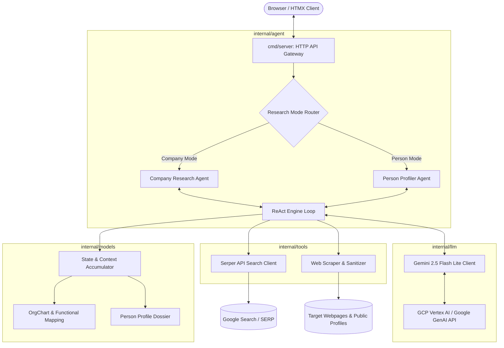

# High-Level Design (HLD) & System Architecture: WebSearch_GO

## 1. Overview & System Design

`WebSearch_GO` is an Agentic AI system written in idiomatic Go and hosted on Google Cloud Platform (GCP). It performs autonomous web-based research along two specialized tracks:
1. **Company Research**: Gathers corporate footprint, extracts executive structure, builds hierarchical org charts, and enables functional/regional drill-downs.
2. **Person Research**: Conducts disambiguation, aggregates multi-source career footprints, and synthesizes structured candidate/professional dossiers.

---

### System Architecture Diagram

---

## 2. Code Functionality & Module Contributions

| Module / Package | Path | Functional Contribution |
| :--- | :--- | :--- |
| **HTTP API Entry** | `cmd/server/main.go` | Loads configuration, initializes dependencies with fail-fast checks, routes company/person research modes, serves the HTMX UI from embedded templates (`internal/web`), renders auto-escaped HTML fragments, probes Chromium once for the per-run rendering toggle, serves `POST /api/research`, `POST /api/rerun`, `POST /api/question` and the `/api/events` SSE stream, and exposes `/healthz` with graceful shutdown. |
| **ReAct Agent Engine** | `internal/agent/engine.go` | Implements the core Reasoning + Acting loop. Drives iterative LLM reasoning, dispatches tool calls, captures observation outputs, and prevents runaway loops via max-iteration bounds. |
| **Company Agent** | `internal/agent/company.go` | Orchestrates multi-phase company discovery (domain search, leadership page extraction, executive hierarchy building, and departmental/regional drill-down formatting). |
| **Person Agent** | `internal/agent/person.go` | Accepts optional company/location disambiguation constraints, queries career footprints across public sources, and aggregates data into an end-to-end dossier. |
| **Search Tool** | `internal/tools/serper.go` | Executes structured web queries via Serper API (regular, news, and site-restricted queries) and returns sanitized snippets and links. |
| **Scraper Tool** | `internal/tools/scraper.go` | Enforces the fetch policy (http/https only; loopback, private and link-local hosts refused), fetches webpage bodies with content-type and size guards, decodes the declared charset, retries transient failures, detects bot-challenge interstitials, strips HTML boilerplate (scripts, styles, ads), deduplicates nested content blocks, and extracts rune-safe truncated text for LLM ingestion. |
| **Browser Renderer** | `internal/tools/scraper_browser.go` | Optional bounded Playwright fallback for HTTP errors, bot challenges and JavaScript shells: launches the full Chromium build, keeps one shared browser context so interstitial clearance cookies survive across renders, waits for network idle, and caps concurrency with a semaphore. Enabled per process or per run; challenges are reported, never solved. |
| **Gemini Client** | `internal/llm/gemini.go` | Wraps the Google GenAI SDK to interface with `gemini-2.5-flash-lite`, configuring system instructions, tool declarations, token budgets, and structured JSON decoding. |
| **Embedded UI Templates** | `internal/web/` | `go:embed`'ed HTML templates (index page + HTMX result fragments) rendered with `html/template` auto-escaping. |
| **Data Models** | `internal/models/` | Defines Go structs for `OrgChart`, `Department`, `Employee`, `PersonProfile`, `Experience`, `Education`, and agent event payloads. |

---

## 3. Implementation Plan

### Phase 1: Workspace Initialization & Environment Scaffolding
- Initialize the Go module (`go.mod`) and declare core dependencies (`google.golang.org/genai`, `net/http`, HTML parser).
- Establish the folder structure (`cmd/`, `internal/agent/`, `internal/llm/`, `internal/tools/`, `internal/models/`).
- Set up configuration loading for GCP project credentials and `SERPER_API_KEY`.

### Phase 2: Tooling & Extraction Layer
- Implement `internal/tools/serper.go` for web search execution.
- Implement `internal/tools/scraper.go` with HTTP client timeouts, content-type and size guards, and HTML text sanitization.
- *(Added later)* `internal/tools/scraper_browser.go` — an opt-in Playwright renderer for pages that require JavaScript — plus the fetch-target policy that keeps scraping scoped to public HTTP(S) hosts.

### Phase 3: Gemini Integration & ReAct Engine
- Implement `internal/llm/gemini.go` with Gemini 2.5 Flash Lite connectivity, function calling declarations, and structured output parsing.
- Implement `internal/agent/engine.go` to handle iterative thought-action-observation cycles.

### Phase 4: Domain Agents Implementation
- Implement `internal/agent/company.go` for org chart discovery and drill-down navigation.
- Implement `internal/agent/person.go` for disambiguation and candidate dossier compilation.

### Phase 5: CLI / API Interface & Verification
- Implement `cmd/server/main.go` as the HTTP gateway with embedded HTMX templates (`internal/web`), auto-escaped fragment rendering, health endpoint, and graceful shutdown.
- Add unit tests across tooling (scraper, serper, cookies), caching, LLM JSON cleaning, and template escaping.
- Containerize with a multi-stage `Dockerfile` ready for GCP Cloud Run deployment.
