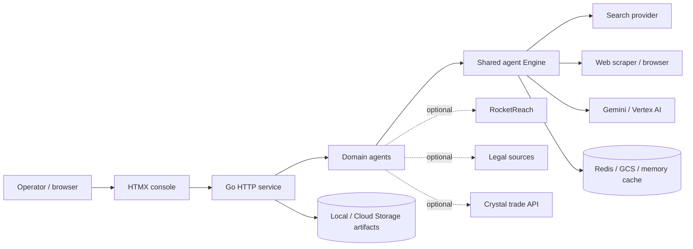
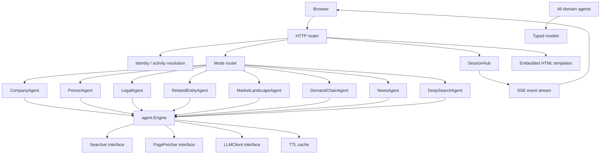
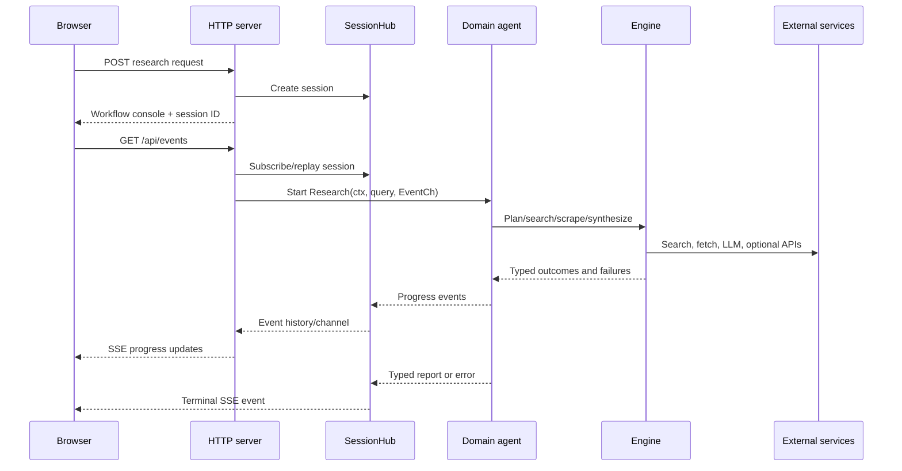

# WebSearch_GO — High-Level Design

## 1. Purpose

WebSearch_GO is an agentic web-research service. It accepts a research request,
confirms the identity or scope being researched, gathers public evidence through
search and scraping, uses Gemini for bounded planning and structured extraction,
and returns a cited domain-specific report.

This document describes the current production-oriented design at a high level.
For implementation-level details, see [ARCHITECTURE.md](ARCHITECTURE.md); for
setup and operational configuration, see [README.md](README.md).

## 2. Goals and non-goals

### Goals

- Provide one web application for multiple research modes:
  company, person, legal, related entity, seller landscape, buyer landscape,
  news, and deep search.
- Produce typed, evidence-backed reports rather than unstructured model prose.
- Keep identity, provenance, budgets, and failure states explicit.
- Stream progress to the browser while long-running research continues.
- Support synchronous requests for simple integrations and asynchronous sessions
  for interactive research.
- Run locally or as a small stateless Cloud Run-style service.
- Keep external dependencies replaceable so the agent package remains testable
  without live APIs.

### Non-goals

- General-purpose autonomous computer use or arbitrary runtime tool creation.
- A persistent workflow scheduler or durable job queue.
- A fully authoritative database of companies, people, legal matters, or markets.
- Unbounded crawling, unrestricted browser automation, or unconstrained LLM output.
- Replacing domain-specific evidence policies with one generic synthesis policy.

## 3. System context



The service owns orchestration, validation, report assembly, session state, and
presentation. External systems provide search results, page content, model
inference, optional profile enrichment, legal data, trade data, and shared
cache storage.

## 4. Architecture overview



The HTTP server is the composition root. It constructs concrete clients,
injects them behind small interfaces into `agent.Engine`, constructs the domain
agents, and owns the route-to-agent mapping.

## 5. Component responsibilities

| Component | Responsibility | Main package |
|---|---|---|
| HTTP server | Routing, request parsing, timeouts, response rendering, security headers, health checks | [`cmd/server`](../cmd/server) |
| Web UI | Operator forms, confirmation cards, workflow console, report fragments, HTMX updates | [`internal/web`](../internal/web) |
| Session hub | In-memory session lifecycle, event history, completion state, bounded cleanup | [`internal/agent/hub.go`](../internal/agent/hub.go) |
| Domain agents | Mode-specific planning, evidence policy, verification, synthesis, and report assembly | [`internal/agent`](../internal/agent) |
| Shared engine | Search, scrape, cache, LLM delegation, concurrency, event emission, and common budgets | [`internal/agent/engine.go`](../internal/agent/engine.go) |
| Models | Typed contracts shared across HTTP, agents, tools, exports, and templates | [`internal/models`](../internal/models) |
| Search/tool clients | Serper search, web scraping, browser/PDF extraction, legal, RocketReach, and trade integrations | [`internal/tools`](../internal/tools) |
| LLM client | Structured Gemini requests with cleaning and retry behavior | [`internal/llm`](../internal/llm) |
| Cache | Search and scrape TTL caching with configurable backend | [`internal/cache`](../internal/cache) |
| Ontology | Activity/product vocabulary and graph-backed resolution | [`internal/ontology`](../internal/ontology) |
| Export | Markdown/PDF generation and local or Cloud Storage destinations | [`internal/export`](../internal/export) |

### Domain agents

- **Company** — discovers company evidence, leadership, organizational
  structure, locations, and profile metrics.
- **Person** — resolves a person identity, builds an evidence-backed dossier,
  and applies employer/location quality control.
- **Legal** — performs bounded case-law and regulatory research and groups
  findings into dockets with deterministic risk summaries.
- **Related entity** — follows company and leadership relationships into
  connected companies.
- **Seller landscape** — discovers and verifies manufacturers, distributors,
  wholesalers, and traders by activity and geography.
- **Buyer landscape** — infers value-chain stages and verifies public consumers
  and demand signals.
- **News** — gathers current, whitelist-constrained articles and synthesizes a
  dated brief.
- **Deep search** — performs multi-round question decomposition, search,
  relevance selection, extraction, review, and cited synthesis.

## 6. Request and execution flows

### 6.1 Asynchronous research flow

1. The browser submits a research request to `POST /api/research` or a
   mode-specific endpoint.
2. The server validates the form and performs identity/activity resolution where
   required.
3. The server creates a session in `SessionHub` and returns a workflow-console
   response containing the session ID.
4. A goroutine runs the selected agent with a bounded `context.Context`.
5. The agent emits progress events to the session event channel.
6. The browser connects to `GET /api/events`; the server replays history and
   streams new events using Server-Sent Events.
7. The agent stores a typed report or error in the session and marks it complete.
8. The final event causes the browser to render the report and available exports.



### 6.2 Synchronous flow

When `sync=1` is requested, the server runs the agent directly under the
request context and renders the final report in the same HTTP response. This is
useful for smaller integrations, but it does not provide the same resilience or
interactive progress experience as the session flow.

### 6.3 Confirmation and gating

Company, person, and related research begins with a confirmation step whenever
the input is ambiguous:

1. Search for candidate identities or profiles.
2. Present candidates with evidence, domains, registration IDs, roles, or
   locations.
3. Let the operator confirm the intended identity.
4. Carry the confirmed identity keys into subsequent search, scraping, and
   synthesis.

Entity gates and domain-specific QC prevent same-named companies or people from
being silently mixed into the final report.

### 6.4 Common agent pipeline

Although each mode has different evidence rules, most follow this shape:

```text
typed request
  -> normalize and validate
  -> domain planning / ontology resolution
  -> bounded search execution
  -> candidate ranking and identity filtering
  -> bounded scrape or snippet collection
  -> evidence normalization and provenance
  -> structured LLM extraction/classification
  -> deterministic QC / freshness / coverage checks
  -> typed report assembly
  -> optional export
```

The LLM is used for bounded planning, classification, extraction, and synthesis.
It does not directly own external tools or establish facts outside the collected
evidence.

## 7. Data and state design

### Request data

Requests use typed query models from `internal/models`. Query objects contain
the requested mode, identity or activity, geography, focus, optional enrichment
flags, and per-run budgets.

### Evidence data

Search hits, scraped pages, snippets, dates, source quality, and provenance are
retained as structured evidence. Final claims must be grounded in collected
source URLs; unsupported or unmatched model citations are removed or reported
according to the mode’s policy.

### Session state

`SessionHub` is process-local and stores:

- session metadata and mode;
- buffered event history;
- current result or error;
- completion signaling;
- company context needed by post-run actions.

Sessions are temporary and cleaned up after a bounded TTL. The session hub is
not a durable queue or database.

### Cache state

Search and scrape results are cached with TTLs. The backend is configurable:

- Redis for shared deployment cache;
- GCS for object-backed cache;
- memory for local or hermetic operation.

Cache keys include relevant scrape mode and authenticated-session scope so a
logged-out failure cannot mask a later authenticated fetch.

### Artifacts

Completed reports can be rendered as Markdown and/or PDF. Destinations are
local filesystem or Cloud Storage, controlled by configuration. Artifacts are
outputs of a run, not the source of truth for active session state.

## 8. Integration boundaries

The agent layer depends on small interfaces rather than concrete providers:

| Boundary | Current implementation | Failure behavior |
|---|---|---|
| Search | Serper client | Per-query error is recorded; cancellation/deadline ends the run |
| Page fetch | HTTP scraper with optional browser/PDF paths | Candidate-level failure; bounded fallback or snippet evidence |
| LLM | Gemini client or Vertex-backed client | Stage failure is surfaced; mode-specific fallback may continue |
| Profile enrichment | RocketReach | Optional, budgeted, and never required for the base report |
| Legal evidence | IndianKanoon, Casemine, Juristway | Bounded source-specific searches and document fetches |
| Trade evidence | Crystal trade API | Optional; disabled when not configured |
| Cache | Redis, GCS, or memory | Configuration-selected; cache failure must not become false evidence |
| Artifact storage | Local directory or GCS | Report remains available in session when export fails |

This dependency inversion allows unit tests to replace searchers, scrapers,
LLM clients, legal sources, and trade sources with deterministic test doubles.

## 9. Reliability and failure handling

- Every research run has a context deadline.
- Search, scrape, LLM, legal, browser, document, and trade operations have
  separate budgets or bounded concurrency.
- Search and scraping are deduplicated and cached where freshness permits.
- Independent searches and page fetches may execute concurrently, but their
  concurrency is capped.
- A failure for one candidate is normally retained as a per-item failure rather
  than terminating the whole run.
- Cancellation and deadline errors are propagated instead of cached as results.
- Panics in background workers are recovered and converted to explicit errors.
- Event delivery is non-blocking; a slow browser can lose an intermediate event
  without blocking research.
- Empty, unavailable, rejected, and unsupported states remain distinguishable
  from successful evidence.

## 10. Security and privacy

- API credentials are supplied through environment/configuration, not source
  control.
- The production image runs as a non-root distroless user.
- HTTP security headers are applied by the server.
- Professional-profile scraping is disabled by default and requires explicit
  configuration/session support.
- Browser fallback and hard-URL escalation are budgeted to limit abuse and
  resource exhaustion.
- Per-host scraping limits reduce load on target sites.
- Entity gates reduce the risk of returning information about a same-named
  company or person.
- Reports expose public-source evidence and should not be treated as an
  authorization boundary for sensitive data.

## 11. Scalability and deployment

The service is horizontally deployable for independent requests, but active
sessions and their SSE connections are process-local. A multi-instance
deployment therefore needs session affinity or a future shared session/event
store for reliable cross-instance streaming.

The current container design is:

```text
Go build stage
  -> static server binary with embedded templates
  -> distroless Debian runtime
  -> non-root process
  -> PORT (default 8080)
```

The main scalability controls are:

- request and browser research timeouts;
- maximum searches, scrapes, pages, steps, and model payload sizes;
- scraper per-host rate/concurrency limits;
- bounded agent worker pools;
- shared Redis/GCS cache to reduce repeated external work;
- optional Cloud Storage artifact output.

## 12. Observability

Operational signals are available through:

- structured/logged agent events with session and step information;
- phase timing summaries;
- search traces and scrape outcomes;
- warnings attached to reports;
- `/healthz` and `/api/health`;
- terminal `[AGENT]` progress logs;
- browser SSE workflow progress;
- per-mode result and QC summaries.

The most important diagnostic correlation key is the research/session ID. It
should be retained in logs, event payloads, and exported run metadata.

## 13. Design decisions

1. **Typed reports over free-form answers**  
   Consumers can render, export, test, and QC structured output.
2. **Evidence-first synthesis**  
   The model plans and transforms collected evidence; it is not treated as an
   independent source of facts.
3. **Domain-owned agents**  
   Company, person, legal, market, demand, news, and deep search have different
   evidence semantics and therefore retain separate policies.
4. **Shared engine interfaces**  
   Search, scraping, LLM, caching, and concurrency mechanics are centralized
   without forcing one generic domain pipeline.
5. **Asynchronous sessions with SSE**  
   Long-running research does not block the browser request and remains
   observable.
6. **Bounded degradation**  
   Partial reports are preferable to fabricated completeness, while failures
   remain visible to the operator.

## 14. Risks and future evolution

### Current risks

- Session state is process-local, which complicates multi-instance SSE routing.
- Domain agents contain some duplicated planning, evidence, and provenance
  mechanics.
- External search, scrape, and LLM quality can change independently of the
  application.
- Large or slow documents and browser-rendered pages can consume a meaningful
  portion of a run budget.
- A shared cache improves cost and latency but requires careful key scoping and
  operational management.

### Recommended evolution

1. Introduce a shared `RunContext` for deadlines, budgets, phase timing, and
   event emission.
2. Extract a reusable `SearchExecutor` for cache, concurrency, cancellation,
   normalization, and traces.
3. Extract common evidence/provenance helpers while retaining domain-specific
   acceptance policies.
4. Add a durable session/event backend if multi-instance streaming becomes a
   requirement.
5. Add contract tests covering cancellation, budget exhaustion, identity
   exclusions, citation grounding, deterministic ordering, and partial failure.

These changes should preserve the existing public agent entry points, report
schemas, event behavior, cache semantics, and explicit partial/unavailable
states.

## 15. Validation strategy

- Unit tests use injected mock searchers, scrapers, LLM clients, and legal/trade
  sources.
- Agent tests verify query planning, identity gates, evidence selection,
  deterministic classification, budgets, and report assembly.
- HTTP tests verify route behavior, health checks, session completion, and SSE
  replay.
- Integration tests are opt-in when they require Gemini, browser rendering,
  external search, or live trade/legal services.
- Race detection is important for session state, concurrent search/scrape work,
  and event delivery.

The normal local validation commands are:

```powershell
go build ./...
go test ./...
```

